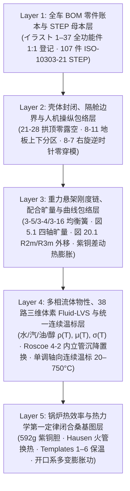

# 真蒸汽机车数字孪生：五层顶层系统工程架构与造车方法论 (SYSTEM_ARCHITECTURE.md)

## 1. 为什么要建立顶层抽象架构？（从“逐点打补丁”到“系统工程防错”）

在经历了 20 余轮精细化迭代后，我们对一个核心问题进行了深刻复盘：**为什么单靠“发现一处穿模修一处、漏一个零件补一个”会不断在后期暴露新问题？**

根本原因在于：真蒸汽机车（Live-Steam Locomotive）不是互不相干零件的堆砌，而是**机械零件台账（BOM）、空间壳体包络（Enclosure）、重力悬挂与配合旷量（Suspension & Clearance）、多相流体拓扑网络（Multi-Phase Fluid Topology）以及热力学第一定律能量收支（First-Law Energy Sankey）**五套强耦合系统的有机整体。历史上出现的典型缺陷，无一例外源于缺失某一上层抽象契约：

| 历史典型问题类别 | 缺失的顶层抽象层 | 系统性根治机制 |
| :--- | :--- | :--- |
| 漏掉 `4-17` 旁通阀本体、把阀体吞并进总管网格 | **L1 部品表（BOM）零件级 1:1 账本** | 建立 BOM 编号 → 独立 STEP 母本 / 功能角色显式映射表，禁止无登记合并关键功能阀件 |
| 驾驶室前妻板拱顶露空、`8-7` 旋转撞左阶梯、`8-6` 掉到地板下 | **L2 壳体封闭与操纵包络契约** | 建立壳体射线封闭门禁（Zero Sky-Leak Ray）+ 右旋螺纹运动方向契约 + 地板上下分区 |
| 先导轮 `R2m` 擦碰 `20-6` 假尾杆、动轮横动拉死或悬空弹簧 | **L3 静载传递链与多级配合旷量矩阵** | 建立簧上重力→均衡梁→主动簧→轴箱→轮轨静定/超静定力链 + 轴箱/摇枕/销孔/热膨胀旷量表 |
| `4-2` 注油器侧接管、煤水车 `31-13` 断流、28°C 酒精比 148°C 蒸汽颜色更暖 | **L4 多相流体物性—LVS拓扑—统一温标层** | 38 路三维体素 `Fluid-LVS` + 多相密度/黏度/Stokes沉降/浮力方程 + 单调温度色标函数 $C(T)$ |
| 保温毡漏算端封、热效率与各路散热不闭合 | **L5 第一定律闭合热平衡桑基图（Sankey）** | 严格按 STEP 实测面积与多层热阻闭合 $\dot{Q}_{\text{fuel}} = \sum \dot{Q}_{\text{useful}} + \sum \dot{Q}_{\text{loss}}$（残差 $<0.2\%$） |

全车声明式顶层架构真值源文件位于：[`configs/d51_system_architecture.json`](../configs/d51_system_architecture.json)，并由 [`scripts/09_verify_cad_and_clearance.py`](../scripts/09_verify_cad_and_clearance.py) 的 **Gate 25 & Gate 26** 在每次构建时自动强制核验。

---

## 2. 五层系统工程抽象模型详解

### Layer 1：全车 BOM 零件账本与独立 STEP 母本层 (`BOM Ledger`)
1. **禁止“顺手合并”功能阀体**：凡在组装图（如 `イラスト 4, 6, 8, 11, 13, 31`）中拥有独立零件编号、独立螺纹锁母（如 `4-17` バイパスバルブ本体 + `LN5-7A` + 下置 `4-15` 中空管螺栓）或独立流体分流/节流物理作用的阀体，必须作为独立 `.step` / `.stl` 零件建模并登记到 `d51_system_architecture.json`，禁止将其简化为管道扫掠的附属方块。
2. **多视图联合定向**：任何零件的局部坐标系、长短边朝向、上下安装面（如 `8-10` 双竖耳立在右地板 `wing_R` **上方**承托 `8-6`，而非吊在地板下方；`8-7` 配合 `6-9` M5 右旋针阀顺时针关死在 `+162°`、逆时针向车体中央旋转开启），必须同时联立爆炸图、局部剖面子图（`図 x.y`）、文字组装顺序（`組立順序`）与实车正交照片交叉锁定。

### Layer 2：壳体封闭、隔舱边界与人机操纵包络层 (`Shell Enclosure & Kinematic Envelope`)
1. **壳体交界面射线密封审计**：锅筒外衣（`25-1`，$R=30.6\text{ mm}$）与驾驶室拱形车顶（`21-1`，$R_{\text{arch}}\approx 39\text{ mm}$）存在天然曲率差。前妻板 `21-28` 必须完整填充锅筒外圆与驾驶室拱顶之间的月牙形区域，并通过沿 X 轴的射线网格扫描验证 `open_arch_rays == 0`。
2. **操纵件全行程扫掠包络**：所有阀门手柄在 `[0%, 100%]` 全行程离散采样下，必须与地板阶梯（`8-11`）、后妻板及相邻阀门保持 $\ge 0.45\text{ mm}$ 物理净空。

### Layer 3：重力悬架刚度链、配合旷量与曲线运动包络层 (`Suspension, Clearances & Curve Envelope`)
真蒸汽机车能够在 `R2m (2000 mm)` 曲线与轨道不平顺上稳定运行而不脱轨、不卡死，完全依赖图纸精心设计的**受载弹性悬挂 + 分级机械旷量（Play / Clearance）**：
1. **完整静载传递链**：整车约 `3.8 kg` 簧上质量通过 **第 1–4 轴 `3-5×8` 四层叠板簧 ↔ `3-4×6` 铰接跷跷板均衡梁 ↔ 后端 `3-16×2` 工作螺旋弹簧**、**先导台车 `4-10` 单固定支点 + `19-4` 杠杆尾端 `19-8 ↔ 4-4` 拉伸螺旋簧** 以及 **从台车 `4-14` 支点 + `19-15` 双端锚固扭簧 + `5-15` 副板簧** 共同分担（实测动轮与台车垂向静挠度 `0.41 ~ 1.04 mm`）。
2. **五类关键配合旷量及其物理影响**：
   - **动轮轴箱横向旷量（`図 5.1`）**：第 1 动轮 `8.5 mm` 轴箱配 `6.1 mm` 隔套留出 **`±1.20 mm`** 大横动旷量，第 2–4 动轮留 **`±0.30 / ±0.20 mm`** 紧配合旷量，使长刚性动轮轴距顺畅内接 `R2m` 弯道并显著降低轮缘导向力 $Y/Q$；
   - **先导摇枕横动旷量（`19-3`）**：`±2.00 mm` 横移配合弹簧自对中，吸收进弯冲击并抑制直线蛇行（`hunting_lat_mm`）；
   - **跨浮动轮对曲柄销轴向旷量**：`±0.35 mm`，释放动轮横动与固定车架十字头之间的过约束；
   - **连杆大/小头径向轴承旷量与油膜挤压阻尼**：总径向间隙 `~0.08 mm`，在活塞死点力反向瞬间产生换向冲击（`rod_knock_n`），由高黏度汽缸油挤压膜（Reynolds Squeeze Film）吸收缓冲；
   - **气缸前盖假尾杆 `20-6` 双孔位（`図 20.1`）**：最小回转半径 `R2m` 时先导轮外摆逼近气缸前盖，因此原厂在 `1-36/1-13` 前缸盖上设置双安装孔——`R3m` 同轴孔（`|Y|=32.50 mm`）与 **`R2m` 外移 `+3.85 mm` 孔（`|Y|=36.35 mm`）**，将过弯轮—杆三维净空直接提升 `+3.4 mm` 以上；
   - **紫铜锅筒差动热膨胀旷量**：`204 mm` 紫铜锅筒（$\alpha_{\text{Cu}} = 16.8\times 10^{-6}\text{ K}^{-1}$）以前端烟室鞍座为死点，升温至 `150°C` 时向驾驶室自由伸长 **`+0.40 mm`**，由火室后滑座膨胀间隙吸收，严禁两端死锁。

### Layer 4：多相流体物性、38 路三维体素 `Fluid-LVS` 与统一连续温标层 (`Multi-Phase Fluid & Unified Thermal Color`)
1. **全车 38 路声明式双侧对称流体网表三维体素 `Fluid-LVS`**：所有水、汽、油、醇、燃气管道（含煤水车内部 `31-6 → 31-5 → 31-13 → 34-6` 共用吸水/压水链、左右双回路 `17-5` 四程过热器、右气缸独立排汽支路 `cyl_7_8_exhaust_R` 及左右气缸独立排液阀 `cyl_1_16_drains_L/R`）均经 GPU 三维体素漫水检验 `Zero-Open / Zero-Necking / Zero-Missing-Wall / Zero-Short`。
2. **Roscoe 置换式注油器（`4-2`）油—汽—水三相物理机制**：
   - **结构真值（`イラスト 4 Fig.1`）**：外部铜管从卧式油罐 **`-Z` 正底部**（`X=+146.2, Y=0.0`）穿出并经罐底 U 形弯接入 `7-9` 给汽总管；而在油罐**内部**，该底孔同轴向上直通一根银焊**竖直溢流立管（Standpipe）**，立管顶端开口位于距油罐内顶仅 `1.15 mm` 处（`Z=+10.90 mm`）。
   - **物理过程**：主蒸汽经底部毛细管及内立管中心孔进入油罐顶空，在裸露黄铜罐壁放热凝结成水珠；液态水密度（$\rho_w \approx 955\text{ kg/m}^3$）大于牛脂复配汽缸油（$\rho_{\text{oil}} \approx 850\text{ kg/m}^3$），水珠按 **Stokes 沉降定律** $v_{\text{Stokes}} = \frac{2(\rho_w-\rho_{\text{oil}})gr_d^2}{9\mu_{\text{oil}}(T)}$ 穿过黏性油层沉入罐底水池；沉底水体积不断累积，通过阿基米德浮力将整层浮油向上抬升，使最顶层的纯净热汽缸油漫过 `Z=+10.90 mm` 的内立管顶口，沿立管中心内孔（被黄铜立管壁与罐底沉水完全物理隔离！）向下流出 `-Z` 底口，在浮力压头与蒸汽室压力脉动共同作用下进入 `7-9` 雾化润湿滑阀与气缸壁（5% 牛脂酯微乳化膜防止湿蒸汽冲刷脱油）。
3. **全车统一温度正相关色标（Unified Temperature-Monotonic Color Standard）**：
   废除按介质种类硬编码冲突颜色的做法，全车所有管道、水箱、醇箱、水面计、注油器分层、气缸腔及三维流向箭头统一由局部实时温度 $T\,(^\circ\text{C})$ 单调映射：
   `20°C 深钴蓝 (#1d4ed8) → 45°C 青蓝 (#06b6d4) → 80°C 翠绿 (#10b981) → 105°C 明黄 (#eab308, 膨胀乏汽) → 148°C 金琥珀 (#f59e0b, 3.8kgf饱和汽水) → 210°C 炽橙 (#f97316, 四程过热活汽) → 420°C 绯红 (#ef4444) → 750°C 白炽黄 (#fef08a)`。

### Layer 5：锅炉热效率与热力学第一定律闭合桑基图层 (`First-Law Energy Sankey`)
以 `boiler_firebox_flues.step` 精确质量（`592.1 g` 无氧紫铜）与换热面积（火室 `79.2 cm²` + 5 烟管 `175.1 cm²` + 四程过热器 `43.7 cm²` + `Templates 1–6` 陶瓷毡与 `3.3 mm` 静止空气夹套）为基准，在每一步严格闭合第一定律能量方程：
$$\dot{Q}_{\text{fuel}} = \underbrace{\dot{Q}_{\text{evap+fw}} + \dot{Q}_{\text{superheat}} + \dot{Q}_{\text{sensible}}}_{\text{有效吸热 } \eta_{\text{boiler}} \dot{Q}_{\text{fuel}}} + \dot{Q}_{\text{flue\_exhaust}} + \dot{Q}_{\text{casing\_loss}} + \dot{Q}_{\text{unburned}}$$
确保任意工况下能量收支闭合残差 `< 0.2%`，从根源上保证升温速率、蒸发量、过热度、续航时间与真实热效率的一致性。
